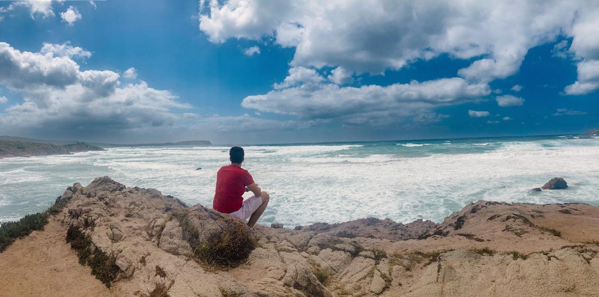

I am a postdoctoral researcher at the [Gran Sasso Science Institute](https://www.gssi.it) in L'Aquila, where I work with Manuel Arca Sedda. I study massive stars and the black holes they leave behind, and I build population models that predict what gravitational-wave detectors should see: LIGO-Virgo-KAGRA today, the Einstein Telescope and LISA in the future.

I co-coordinate the LISA Astrophysics working group on dynamical binaries in the Galaxy and the Local Volume, and I am a member of the Einstein Telescope and LGWA collaborations.

On this website you can find:

- [Research](/research/): what I work on
- [Papers](/papers/): my publications
- [Software](/software/): the codes I develop and use
- [Talks](/talks/): talks and seminars
- [Teaching and Outreach](/teaching/): courses, students and outreach
- [CV](/cv/): my CV

My journey in brief
======

- **2025 – present**: Postdoctoral researcher at GSSI, L'Aquila. In September 2026 I was a visiting researcher at the University of Geneva, hosted by Tassos Fragos through the ACME Transnational Access programme.
- **2020 – 2024**: PhD in Astrophysics and Cosmology at SISSA, Trieste, supervised by Mario Spera, Marco Limongi and Alessandro Bressan. Thesis: *Massive black holes from single and binary stars*, graduated cum laude.
- **2018 – 2020**: MSc in Astronomy and Astrophysics at Sapienza University of Rome. Thesis on the initial mass–remnant mass relation from core-collapse supernovae, with Marco Limongi and Raffaella Schneider.
- **2014 – 2018**: BSc (Astronomy and Astrophysics curriculum) at Sapienza University of Rome. Thesis on observing Saturn with the T.A.CO.R. telescope.
